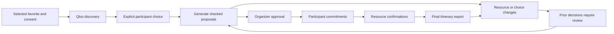
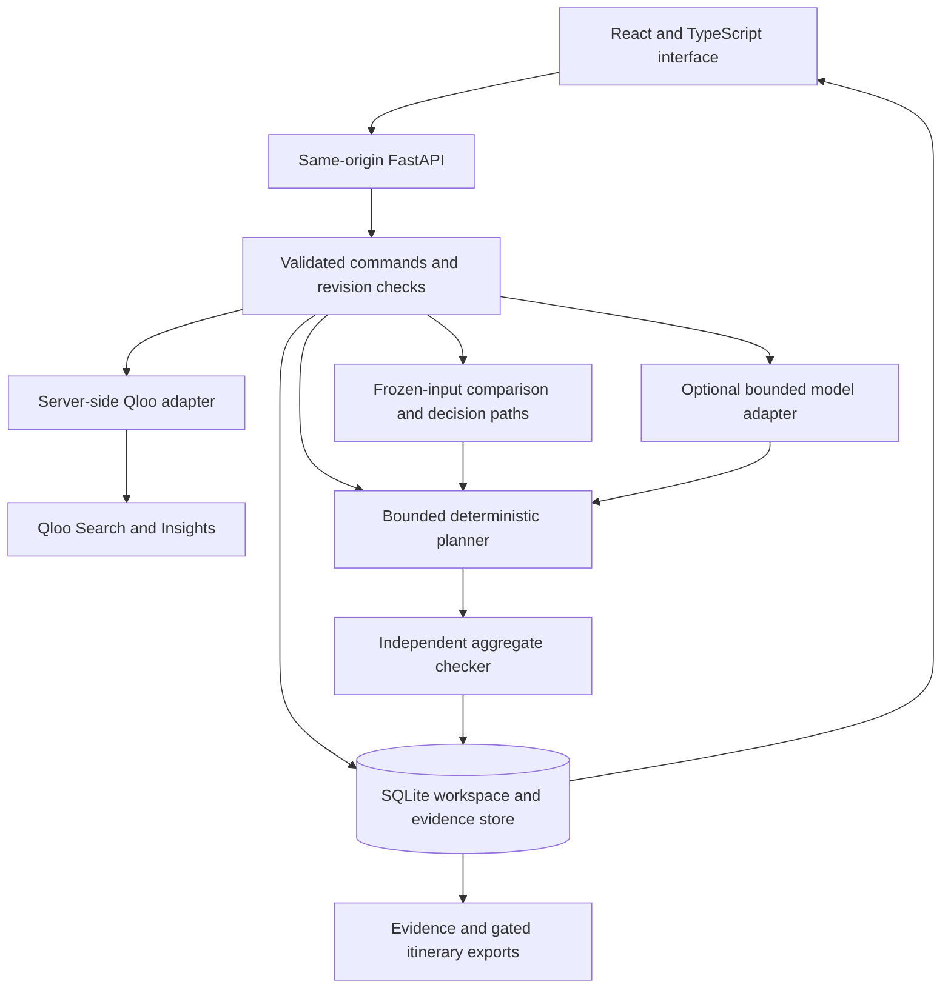

# UNBLOCK — From Cultural Interest to a Checked Outing

**Python 3.14 · FastAPI · React · TypeScript · Qloo · SQLite · Docker · Render**

[Live product](https://unblock-demo.onrender.com) · [CI](https://github.com/ankitlade12/unblock-qloo/actions/workflows/verify.yml) · [Architecture](docs/architecture.md) · [Data provenance](docs/data-provenance.md) · [MIT license](LICENSE)

> **Discover something people want to do. Make a plan they can actually join.**

UNBLOCK connects cultural discovery with the practical work of organizing community outings. Qloo surfaces films related to a selected favorite. People explicitly choose what interests them. A planning workflow checks those choices against transport, accessibility, companion seats, timing, shared inventory, and budget.

The product starts with the people attending—not just a destination. It carries their requirements through planning, approval, commitments, resource confirmation, and disruption, with an inspectable decision trail at every step.

**Built for:** the Qloo Agentic Hackathon

**Proposed first user:** community activity coordinators organizing small cultural outings

**Demo mode:** live Qloo discovery with fictional participants and operations

## Quick Highlights

- **Qloo-to-Planning Evidence** — follow a favorite through a provider-backed suggestion, explicit choice, practical checks, and the actual planning outcome.
- **People-First Constraints** — accessibility, companion needs, return deadlines, and individual contribution limits remain part of every check.
- **Checked Group Proposals** — bounded search generates candidates; a separate aggregate checker verifies feasibility and cost.
- **Explicit Decision Gates** — organizer approval, participant commitment, and provider confirmation remain separate.
- **Repair After Disruption** — changed resources invalidate earlier decisions; inspect changed assignments and costs before approving again.
- **Matched-Input Comparison** — preserve original choices, constraints, and evaluation time rather than manufacture a discovery win.
- **Inspectable Exports** — retain input snapshots, decision provenance, checked results, and unresolved conditions.
- **Bounded Provider Access** — server-side credentials, explicit consent, recorded-result caching, and persistent request budgets.
- **Responsive Product Story** — six chapters connect people, choices, possibilities, commitments, disruption, and evidence.

## Live Deployment

| Surface | Location | Access |
|---|---|---|
| Product | [unblock-demo.onrender.com](https://unblock-demo.onrender.com) | Public synthetic walkthrough; no judge credentials required |
| Health | [/api/health](https://unblock-demo.onrender.com/api/health) | Public runtime status |
| Source | [GitHub repository](https://github.com/ankitlade12/unblock-qloo) | Public, MIT licensed |
| Verification | [verify.yml](.github/workflows/verify.yml) | Offline backend, build, and browser checks |
| Availability checks | [judging-health.yml](.github/workflows/judging-health.yml) | Time-bounded judging checks without Qloo requests |

Each visitor receives an isolated demo workspace that expires after 24 hours. The session owner can act as every **fictional** participant. No real booking, payment, provider message, or observed attendance is implied. Do not enter private participant records.

## The Problem

For an activity coordinator, choosing a film is only one decision. A workable afternoon also needs answers to questions such as:

- Can Jordan travel step-free with a companion, using both a seat and a ticket?
- Does Morgan's selected venue provide the required hearing loop?
- Can everyone return before their individual deadlines?
- Do shared tickets, vehicles, and the organizer's budget cover the proposed groups?
- If a shuttle becomes unavailable, who needs a different plan and renewed approval?

UNBLOCK explores this gap between cultural interest and practical participation. Its proposed audience and workflow are specific; real organizer demand and benefit still require validation.

## The Solution

UNBLOCK connects three kinds of evidence:

| Question | Source of the answer |
|---|---|
| What might this person enjoy? | Qloo recommendations from explicitly selected cultural favorites |
| What does this person choose? | A recorded response to the reviewed screening |
| What can the group actually do? | Operational inputs, checked assignments, and explicit confirmation gates |

A suggestion never becomes interest automatically. Individual eligibility never establishes group capacity or affordability. A checked proposal never becomes a booking automatically.

## Architecture Overview

### The Outing Lifecycle



### System Architecture



The public deployment uses the deterministic planning workflow. The optional language-model adapter is disabled and has not been verified against a live model provider.

### Tech Stack

| Layer | Technology | Purpose |
|---|---|---|
| Interface | React, TypeScript, Vite | Responsive organizer workflow and participant-role simulation |
| API | Python, FastAPI, Pydantic | Validated commands, state transitions, imports, and exports |
| Cultural discovery | Qloo Search and Insights | Reviewed identities and taste-based recommendations |
| Planning | Bounded backtracking search | Candidate assignments under operational constraints |
| Verification | Separate aggregate checker | Recompute capacity, inventory, conflicts, and integer-cent costs |
| Persistence | SQLite | Expiring workspaces, snapshots, evidence, and durable request limits |
| Testing | pytest, Playwright, axe | Backend regressions, browser journeys, and automated accessibility |
| Delivery | Docker, Render, GitHub Actions | Hosted application, persistent disk, and CI |

For implementation details, see [architecture](docs/architecture.md).

## Product Features

### Cultural Discovery With Provenance

Review film identities, select favorites with explicit consent, and retrieve Qloo recommendations. UNBLOCK intersects returned entities with the reviewed catalogue and distinguishes newly surfaced options from existing interests. Retrieval time, source evidence, and recorded-result reuse remain visible. Missing matches never become invented affinity scores.

### Choices That Preserve Individual Requirements

Only current, explicit interested responses can support assignments. Maybe, rejected, unseen, withdrawn, and stale-version choices are ineligible. Functional requirements are entered directly; they are not inferred from taste or sent to Qloo.

### Checked Proposals and Separate Commitments

Planning considers access, timing, companion seats and tickets, shared inventory, vehicle conflicts, minimum groups, and budget. Candidates retain their original inputs. Approval applies to an exact version; participant commitments and required resource evidence must then satisfy the final-export gates.

### Discovery Comparisons That Explain the Result

**Compare discovery** freezes the original choices, operational inputs, and evaluation clock. Both searches use the same planner and verifier. Each latest participant/event decision has an exported path showing its source, response, individual offer checks, assigned offer, and outcome.

An accepted option may remain unselected. A missing plan does not become a zero-cost success, and incomplete searches do not establish optimality. Unrelated operational edits invalidate further comparison.

### Disruption, Repair, and Historical Evidence

A changed transport offer or participant decision makes affected proposals require review. Replanning preserves requirements and shows changed assignments and costs. Historical snapshots remain inspectable; approvals do not silently carry over. Explicit post-event simulation enables fictional outcome entry without changing real time or planning validity.

## Judge Quick Start

Open [the live demo](https://unblock-demo.onrender.com) and choose **Explore the demo**.

1. **Meet the people:** choose **Walk through the story** and inspect the individual requirements.
2. **Run live discovery:** open **Discover**, keep Alex selected, consent to the reviewed Inside Out profile, load it, and run Qloo discovery. Loading the profile makes no provider call; discovery uses one Insights request.
3. **Record a choice:** open **Compare discovery**, freeze the baseline, select Qloo-backed suggestions, and explicitly record a fictional response to a returned suggestion.
4. **Inspect the contribution:** compare checked plans and read **Follow each choice into the plan**. Expand the source evidence and export the comparison.
5. **Generate an actionable proposal:** use **Plans** to generate a current candidate separately. Approve that version, record fictional participant commitments, and confirm the required seats and tickets before final export.
6. **Handle a disruption:** return to the story, make a used shuttle unavailable, and check remaining options. Inspect changed assignments, costs, and required review.

For an honest no-plan example, set the organizer budget to $0 and generate again. Provider results can vary; use the result actually returned rather than assume a particular match.

### What the Demonstration Establishes

| Observed scenario | What it shows | What it does not establish |
|---|---|---|
| Inside Out surfaced Coco and The Grand Budapest Hotel beyond Alex's existing interests | Live cultural discovery and catalogue mapping | Human relevance or acceptance |
| A scripted Coco acceptance passed individual checks but was not selected in the group comparison | A traceable distinction between discovery, choice, and assignment | Coverage or cost improvement |
| The authored baseline serves 12 fictional participants for $224 | Feasibility under the authored inputs | Real attendance or market performance |
| A demonstrated shuttle disruption produced a $246 repair with six changed assignments and coverage of 12 | Explicit operational trade-offs and repair behavior | Savings or a guaranteed outcome for other inputs |

## Local Installation

Requirements: Python 3.14 and Node 22.12+.

```sh
git clone https://github.com/ankitlade12/unblock-qloo.git
cd unblock-qloo
python3 -m venv .venv
.venv/bin/pip install -r requirements.txt
npm ci --prefix apps/web
cp .env.example .env
./run.sh
```

Open http://127.0.0.1:8011. No provider key is needed for the synthetic planning workflow. `run.sh` loads `.env` as trusted shell configuration, builds the frontend, and serves UI and API together.

## Qloo Integration

The server uses `/search` for explicit entity review and `/v2/insights` with `filter.type=urn:entity:movie` and selected `signal.interests.entities`.

1. Review a returned identity rather than automatically resolve an ambiguous title.
2. Obtain explicit consent and select cultural favorites.
3. Retrieve suggestions and intersect their entity IDs with reviewed catalogue identities.
4. Keep source evidence and require an explicit choice before planning.
5. Retain provenance through the matched-input comparison and export.

[reviewed_catalogue.json](services/api/reviewed_catalogue.json) contains reviewed identities for the quick demo; it is not a synthetic recommendation response. Repeated requests can reuse workspace-private evidence, labeled as recorded. Default attempt budgets are 40 per workspace and 200 per deployment per UTC day, including failures. Creating a new workspace does not reset the deployment budget.

## Reproducible Testing

```sh
# Backend unit and API integration tests
.venv/bin/python -m pytest -q

# TypeScript validation and production frontend build
npm run build --prefix apps/web

# Install Chromium once
cd apps/web
npx playwright install chromium
cd ../..

# Start the application in another terminal, then run browser journeys
npm run test:e2e --prefix apps/web
```

Verified on October 28, 2026, for application release `8dcae65`:

```text
Backend tests              55 passed
Production build           passed
Browser journeys           6 passed locally and in CI
Expanded public scenarios  10 groups passed
Live expanded check        1 Qloo request; 0 browser exceptions
```

Coverage includes solver boundaries, exact-version decisions, isolation, stale writes, import validation, exports, quota persistence, consent withdrawal, disruption/repair, mobile layout, and automated accessibility. The backend tests emit a Starlette test-transport deprecation warning. Chromium and axe checks are not cross-browser verification, human accessibility certification, or load testing.

Set `PLAYWRIGHT_BASE_URL` for another origin or `CHROMIUM_PATH` for an installed Chromium. Repeated browser suites can hit the one-minute workspace-creation limit; use a fresh isolated database locally or allow the rate window to expire.

### Opt-In Live Checks

These checks create synthetic workspaces and spend provider requests:

```sh
# Three reviewed profiles; three live requests and scripted choices
.venv/bin/python scripts/verify_judge.py --allow-live --base-url https://unblock-demo.onrender.com

# Expanded browser check; one live request, exact exports, and mobile checks
QA_BASE_URL=https://unblock-demo.onrender.com node scripts/browser_qa.cjs --allow-live
```

Generated reports and captures default to ignored `data/` and stay local. The public README does not require image or video assets.

## Repository Structure

```text
unblock-qloo/
├── apps/web/src/                 # React interface and product story
├── apps/web/e2e/                 # Browser regression journeys
├── services/api/
│   ├── main.py                  # Commands, gates, API routes, and exports
│   ├── domain.py                # Validated schemas and synthetic fixtures
│   ├── planner.py               # Bounded search and aggregate verification
│   ├── comparison.py            # Frozen comparisons and decision paths
│   ├── qloo.py                  # Cultural discovery, cache, and provenance
│   ├── agent.py                 # Optional bounded model adapter
│   └── store.py                 # SQLite workspaces and durable limits
├── tests/                       # Backend and API regressions
├── scripts/                     # Opt-in live verification
├── docs/                        # Architecture and data provenance only
├── .github/workflows/           # Offline verification and judging health
├── Dockerfile
├── compose.yaml
├── render.yaml
├── requirements.txt
└── .env.example
```

## Configuration

Copy [.env.example](.env.example) for local development. Use host secrets for deployed credentials.

| Variable | Purpose |
|---|---|
| `QLOO_API_KEY` | Enables server-side cultural discovery |
| `QLOO_API_ORIGIN` | Defaults to the hackathon API; must match the issued credential |
| `QLOO_CALL_BUDGET` / `QLOO_DAILY_CALL_BUDGET` | Workspace and deployment attempt caps |
| `DATABASE_PATH` | SQLite file; use persistent storage when hosted |
| `APP_ORIGIN` | Exact browser origin for same-origin checks |
| `COOKIE_SECURE` | `true` behind HTTPS; `false` for local HTTP |
| `PORT` | Application port; defaults to 8011 locally |
| `MODEL_API_KEY` / `MODEL_NAME` | Optional Responses-compatible model assistant |
| `MODEL_API_ORIGIN` | Allowlisted origin for the optional model adapter |
| `MODEL_DAILY_CALL_BUDGET` | Deployment-wide optional model attempt cap |

The optional model may inspect context, list missing requirements, request consented discovery, and generate checked drafts. It cannot change choices, approve, commit, confirm, book, pay, or send. No model is required for the public deterministic workflow.

## Deployment

For local containers:

```sh
docker compose up --build
```

Open http://localhost:8011. [Dockerfile](Dockerfile) and [render.yaml](render.yaml) provide a single-service deployment path. Review hosting costs before provisioning paid resources.

1. Connect the repository and use its Docker runtime.
2. Run one application process with persistent SQLite storage at `/app/data`.
3. Set `APP_ORIGIN` to the exact HTTPS URL and `COOKIE_SECURE=true`.
4. Configure provider credentials through host secrets.
5. Ensure the mounted disk is writable by container user 10001.
6. Verify `/api/health`, isolated browser sessions, exports, provider access, and persistence across a restart.

The public Render service uses one instance and a persistent disk. Automatic deployment is disabled; deploy reviewed commits after CI passes. Do not horizontally scale this SQLite prototype or use ephemeral database storage.

## API Surface

| Method | Route | Purpose |
|---|---|---|
| `GET` | `/api/health` | Runtime readiness |
| `POST` | `/api/demo` | Create an isolated synthetic workspace |
| `GET` | `/api/state` | Read cookie-scoped workspace state |
| `POST` | `/api/command` | Validate and execute a domain action |
| `GET` | `/api/comparisons/{cid}/export` | Export frozen inputs, provenance, and checked comparison |
| `GET` | `/api/proposals/{pid}/export` | Export proposal evidence or a gated final itinerary |
| `DELETE` | `/api/workspace` | Delete the current workspace |

Commands carry an input revision, action, target, data, and idempotency key. Mutations require the application request header and same-origin checks. Concurrent edits return a conflict rather than silently overwrite newer state.

## Privacy and Decision Boundaries

- Operational fixtures are fictional; cultural evidence does not validate event or transport facts.
- Credentials remain server-side and are excluded from Git.
- Functional needs are entered directly and never inferred from taste.
- Consent withdrawal removes favorites and suggestions; workspace deletion removes the stored workspace.
- Raw provider responses stay private to the workspace and are excluded from ordinary state and evidence exports.
- Imports are schema-validated and bounded; imported descriptions have no instruction authority.
- Proposal snapshots preserve historical inputs; material changes require review.
- Planning is bounded to 12 events, eight offers, and a three-second search budget. Checked candidates remain distinct from established optima.
- The public session model is for fictional role simulation, not real participant authorization.

See [data provenance](docs/data-provenance.md) for retention and evidence details.

## Production Boundary and Next Steps

UNBLOCK is a working hackathon prototype. Real organizer accounts, participant invitations, participant-level authorization, verified operational providers, and production data-management controls are not implemented.

The proposed next step is a formative study with community activity coordinators using matched fictional tasks. Counterbalance the current process and UNBLOCK, include data-entry time, and measure planning/repair effort, missed essential requirements, and facilitator intervention. No organizer pilot, time savings, attendance improvement, or causal Qloo benefit has been established.

Before real outings, add managed identity and consent flows, verified event and transport sources, provider agreements, a production database, backups, retention operations, and human accessibility testing. Expand beyond film only after the core workflow and audience value are validated.

## License

[MIT](LICENSE) © 2026 Ankit Hemant Lade.

*Discover. Choose. Check. Commit. Adapt.*
