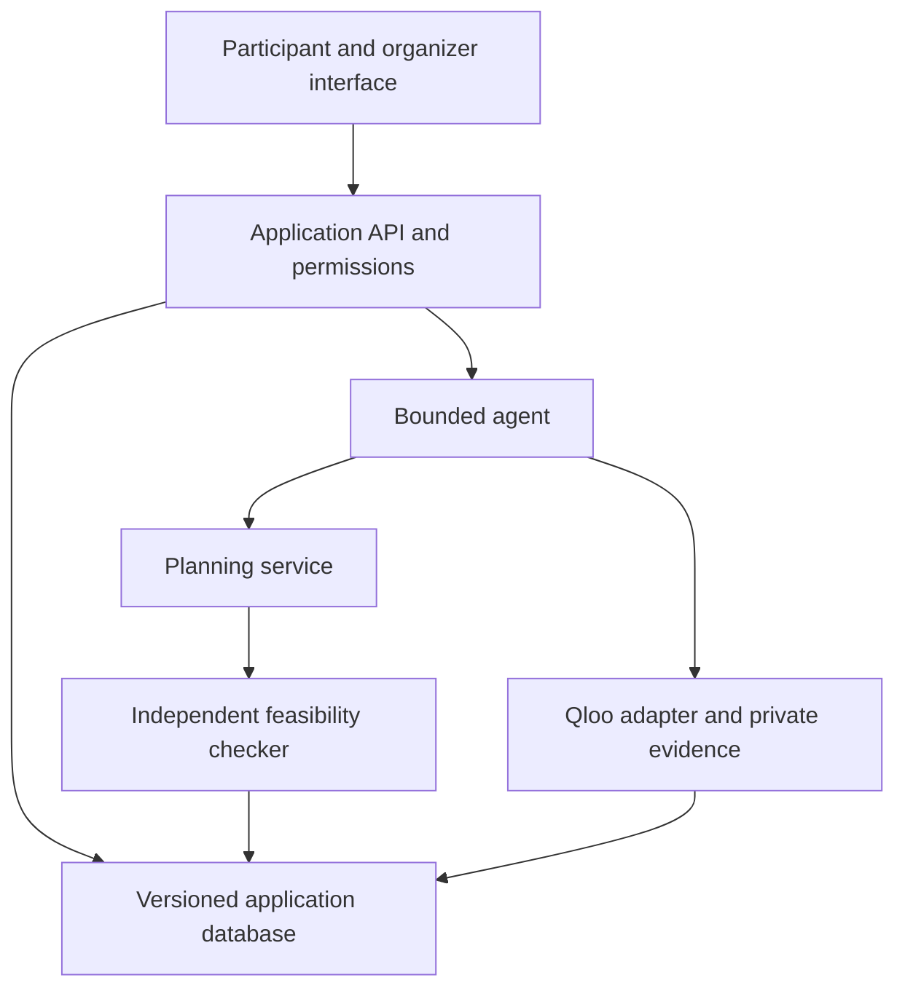
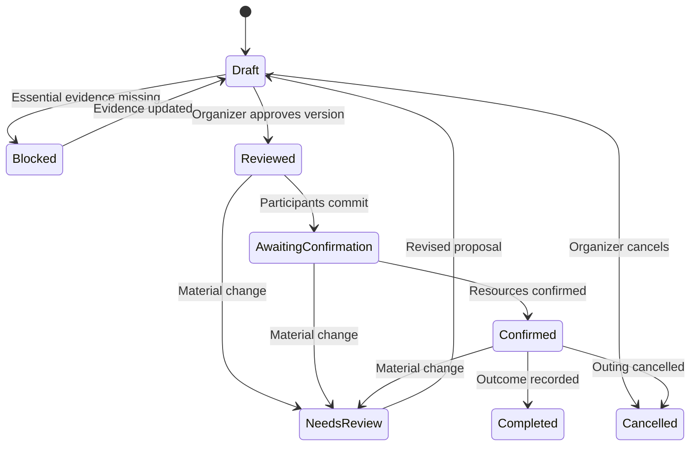

# UNBLOCK — Product Requirements and Technical Design

**Version:** 1.0  
**Prepared for:** Ankit Hemant Lade  
**Date:** October 27, 2026  
**Planning timezone:** America/Chicago  
**Target:** Qloo Agentic Hackathon  
**Status:** Proposed product specification; implementation and validation pending.

> UNBLOCK is a Qloo-powered AI agent that discovers cultural experiences community members want to share and coordinates affordable group outings around their transport, ticketing, and accessibility needs.

This document specifies a product that connects cultural discovery with feasible shared outings.

All capabilities below are proposed unless explicitly described as external research findings. No live Qloo experiment, organizer interview, participant trial, booking, deployment, or measured impact is claimed. Numerical examples and targets are labeled. Finalist selection and worldwide novelty cannot be guaranteed.

## Contents

1. Product thesis and decision
2. Problem and research evidence
3. Audience and first customer
4. Competition and differentiation
5. Hackathon alignment
6. Scope and priorities
7. End-to-end journeys
8. User experience and screens
9. Functional requirements
10. Qloo integration
11. Agent behavior and tool contracts
12. Feasibility and planning engine
13. Data model
14. System architecture
15. Application API contracts
16. Evidence, privacy, and permissions
17. Failure handling and recovery
18. Evaluation and success measures
19. Testing and acceptance
20. Demonstration design
21. Delivery roadmap
22. Deployment and operating plan
23. Business model and pilot
24. Risks and decisions
25. Submission package
26. Implementation backlog
27. Definition of done
28. Sources

## 1. Product thesis and decision

### 1.1 What we are building

UNBLOCK helps an existing community organizer discover and coordinate outings for members who face practical barriers to participating. It connects three decisions:

1. Which experiences might people enjoy?
2. Which of those experiences do they explicitly want to attend?
3. Which accepted choices can be delivered together using available resources?

Qloo supports the first decision through cultural affinity. Participants own the second decision. Deterministic planning and verified operational information govern the third.

The product must keep these stages distinct:

**Suggested relevance → expressed interest → feasible plan → participant commitment → confirmed resources → observed attendance.**

A recommendation is not an RSVP. A feasible plan is not a booking. A booking is not evidence that someone attended.

### 1.2 The central hypothesis

People with different initial favorites may accept an unexpected shared experience. Discovering that overlap could enable pooled transportation, a group ticket offer, or a practical coordinated outing that separate initial plans could not support.

This is a testable hypothesis. It must not be presented as an established result.

### 1.3 The decision to validate

Proceed with a focused prototype and a small organizer-led test. Continue toward a full product only if:

- An organizer identifies a repeated planning problem.
- Available event and resource information can support realistic plans.
- People accept some of the proposed cultural discoveries.
- The workflow reduces coordination effort or improves feasible participation.
- Qloo contributes useful discovery beyond a simple catalogue or LLM baseline.

If Qloo does not improve discovery, do not disguise this with additional agent roles or decorative explanations. Reconsider the hackathon direction.

### 1.4 What success looks like

An organizer can review a plan and say:

- These participants actually expressed interest.
- The events and resource options are real or clearly labeled demonstration data.
- The proposed costs and requirements are supported.
- I understand who can participate and who remains unserved.
- This plan was useful to produce and is ready for the next confirmation step.

## 2. Problem and research evidence

### 2.1 Community problem

An organizer may have interested members, several events, and limited transport or ticket support. Planning requires reconciling individual preferences, availability, access requirements, capacities, and spending limits.

The opportunity is to reduce avoidable coordination failures. Software cannot manufacture funding, transportation capacity, or accessibility that does not exist.

### 2.2 Evidence already reviewed

| Finding | Implication | Limitation |
| --- | --- | --- |
| Greater Philadelphia research reports cost, time, and transport/parking barriers to arts participation. [S3] | Interest alone does not make attendance feasible. | Regional research does not prove demand for our software. |
| Arts Access supplies cultural access and scheduled transportation; its current page says 2026 transportation funding capacity has been reached. [S4] | Resource constraints are real and consequential. | This does not show that its existing allocation is inefficient. |
| Spektrix supports access requirements, relevant communications, and accessible booking workflows. [S5] | Basic accommodation collection is an established capability. | Published product descriptions do not establish every implementation detail. |
| Tickets for Good distributes free or discounted event opportunities. [S6] | Ticket-access infrastructure and potential partners already exist. | No integration or partnership with UNBLOCK is established. |

A real problem is necessary but insufficient. We still need evidence that UNBLOCK improves a decision an organizer makes.

### 2.3 Current gaps

- No organizer has supplied a real planning case for this project.
- Willingness to pay is unknown.
- Actual event-to-Qloo entity coverage is unknown.
- The amount of useful preference overlap is unknown.
- Transport pricing and availability have not been obtained.
- The reduction in staff effort has not been measured.
- Participant interest-to-attendance conversion is unknown.

## 3. Audience and first customer

### 3.1 Initial setting

Pilot with one adult community organization that already arranges outings. Dallas is the default geography because the product owner is based there; this is a proposed starting location, not a confirmed pilot.

Suitable organizations include community centers, cultural-access nonprofits, and adult membership programs with existing transport partners.

Begin with adults and an organizer-mediated group. Open public stranger matching and services involving minors are outside the first release.

### 3.2 Roles

| Role | Needs | Allowed actions |
| --- | --- | --- |
| Participant | Relevant experiences, practical information, control over participation | Manage own favorites, requirements, interest, commitments, and withdrawal |
| Organizer | Feasible plans with explainable trade-offs | Manage catalogue, resource offers, planning policies, proposals, and confirmations |
| Resource provider | Accurate request details | In MVP, responds outside the app; organizer records evidence |
| Judge/demo visitor | An end-to-end demonstration without setup | Use an isolated synthetic workspace and live discovery where available |
| Administrator | Reliability and responsible use | Manage quotas and configuration; access private data only when justified |

### 3.3 Jobs to be done

**Participant:** “Help me discover something I want to attend and tell me exactly what the proposed outing requires.”

**Organizer:** “Help me turn different interests into workable outings without repeatedly reconciling spreadsheets, messages, and resource constraints.”

**Provider:** “Give me a precise request with date, capacity, access requirements, and confirmation deadline.”

### 3.4 Data minimization

Ask about functional needs such as step-free boarding, a companion seat, return time, or seating requirements. Do not require diagnoses. Keep exact pickup addresses out of recommendation requests and public demonstrations.

Participants may decline taste profiling and choose directly from the catalogue. This is a valid product path, even though it is not evidence of Qloo's incremental value.

## 4. Competition and differentiation

### 4.1 Existing alternatives

| Alternative | Established capability | Proposed UNBLOCK distinction |
| --- | --- | --- |
| AccessNow | Discovery of places by accessibility features [S7] | Plans group participation using accepted event choices and actual support options |
| Arts Access | Donated cultural opportunities and scheduled transport [S4] | Assists organizers with cross-event preference and resource decisions |
| Spektrix | Access needs, ticketing, communications, and audience operations [S5] | Explores new accepted choices that may enable pooled outings |
| TasteBridge | Qloo-based group decisions with constraints [S8] | Connects discovery to transport/ticket package feasibility and commitments |
| ReelBalance / Common Bill | Cultural programme planning and repair [S9][S10] | Focuses on individual participation and shared operational support |
| Spreadsheet plus survey | Explicit preferences and manual coordination | Automates evidence-linked discovery and repeated feasibility checking |

### 4.2 Defensible claim

UNBLOCK proposes to connect cross-domain cultural discovery, explicit participant acceptance, and shared-resource planning in one inspectable workflow.

It does not claim to invent group recommendations, matching, operations research, accessible outings, or event coordination.

### 4.3 Differentiation that must be earned

The main comparison is whether Qloo-assisted discovery produces useful accepted options, under equal discovery effort, that help the planner find better feasible outings.

A larger number of tool calls, a graph animation, or a higher Qloo affinity score does not establish product superiority.

### 4.4 Long-term defensibility hypothesis

Potential advantages would come from trusted organizer workflows, reliable integrations, and consented operational feedback. Merely accessing the same Qloo API as other teams is not a durable advantage.

## 5. Hackathon alignment

The challenge requires an agentic application using Qloo, a functional externally hosted demo, public source, a visible open-source license, and a project description. The overview says video is optional. The rules identify implementation, design, impact, and idea quality as equally weighted. [S1][S2]

The submission deadline is October 30, 2026, 11:45 p.m. Eastern / 10:45 p.m. Chicago. Judging runs November 2–5. The overview announces a November 5 finalist appearance and preparation requirements. Recheck organizer updates before submission. [S1][S2]

| Criterion | Required project evidence |
| --- | --- |
| Implementation | Real Qloo requests, correct entity handling, bounded agent tools, independent feasibility checks |
| Design | Complete participant and organizer flow, usable on mobile and keyboard |
| Impact | A concrete organizer problem and honestly reported pilot evidence |
| Idea quality | Evidence that cultural discovery changes accepted choices and practical plans |

This is a product specification, not an eligibility determination. The representative must review the official rules.

## 6. Scope and priorities

### 6.1 P0: hackathon vertical slice

- One organization and one planning window.
- Approximately 12 synthetic participants, 8–12 curated events, and a few resource offers for the demonstration.
- Participant favorites resolved to Qloo entities.
- Qloo-grounded suggestions tied to actual catalogue entities.
- Explicit event interest and non-negotiable requirements.
- Fixed event schedules and preconfigured transport packages.
- Budget, capacity, timing, and accessibility feasibility checks.
- Two or three candidate plans where feasible.
- Versioned organizer approval and participant commitment.
- Disruption and replanning.
- Evidence labels, audit trail, and honest abstention.
- Exportable itinerary and provider request draft.
- Public isolated demo and documented setup.

These sizes are planning targets, not existing assets or demonstrated capacity.

### 6.2 P1: pilot

- Secure invitations and organizer authentication.
- CSV catalogue/resource import.
- Multiple planning windows.
- Versioned provider confirmations and holds.
- Attendance and cancellation recording.
- Accessibility testing with real users.
- Small randomized recommendation evaluation.

### 6.3 P2: subsequent product

- Authorized ticketing and transport integrations.
- Multi-organization resource sharing with explicit agreements.
- Multilingual participant experience.
- Historical service-coverage policies.
- Mobile application if validated usage warrants it.
- Advanced routing, only with suitable providers and constraints.

### 6.4 Non-goals

- Medical, dietary, or clinical recommendations.
- Inferring disability, income, ethnicity, or personality from cultural taste.
- Autonomous spending, booking, or external outreach in the MVP.
- Changing performance schedules without provider agreement.
- A general-purpose citywide marketplace.
- A new transportation dispatch system.
- Guaranteed enjoyment, attendance, cost savings, or finalist selection.
- Fabricated provider inventory or simulated personas presented as real users.

## 7. End-to-end journeys

### 7.1 Organizer setup

1. Create a planning window with dates, currency, budget, and return-time rules.
2. Import or enter a small catalogue with source links and observation times.
3. Link events to featured Qloo entities: artist, film, book, or place where appropriate.
4. Review ambiguous identities.
5. Enter resource offers with capacity, availability, price, terms, and expiry.
6. Define any minimum service commitments and tie-breaking rules.
7. Invite participants or open an isolated demonstration dataset.

The application reports missing information before allowing an actionable plan.

### 7.2 Participant discovery

1. Explain what the service does and what information will be shared.
2. Collect a few voluntary favorites and disambiguate titles or artists.
3. Collect availability and functional requirements.
4. Show a small set of suggestions with event details and grounded explanations.
5. Let the participant mark each event: interested, maybe, not interested, or unseen.
6. Allow participants to add an event from the catalogue directly.
7. Save responses with the event version and disclosure shown.

Only “interested” choices may support an actionable assignment. “Maybe” choices may appear in an exploratory draft but must be labeled and excluded from confirmed counts.

### 7.3 Organizer planning

1. Review complete and incomplete participant responses.
2. Ask the agent to identify feasible options.
3. Inspect candidate plans and unserved participants.
4. Review exact costs, capacity consumption, assumptions, and unresolved facts.
5. Approve one proposal version.
6. Request participant commitment to that exact itinerary.
7. Record resource holds or confirmations and reconfirm feasibility.
8. Export the final itinerary only when required confirmations are present.

### 7.4 Disruption

1. An organizer records a cancellation, price change, access-status change, or participant withdrawal.
2. The system marks dependent proposal versions stale.
3. The agent retrieves updated inputs and proposes a repair.
4. A diff shows changed people, events, costs, and requirements.
5. Material changes require renewed organizer approval and affected participant commitments.
6. If no repair is feasible, explain the blocking constraints without relaxing them silently.

### 7.5 Completion

Record attendance as attended, did not attend, cancelled, or unknown. Record feedback separately. Do not fill in attendance from the existence of a confirmed itinerary.

## 8. User experience and screens

| Screen | Primary decision | Essential elements |
| --- | --- | --- |
| Welcome | Understand the service | Plain-language purpose, live/demo badge, participant/organizer entry |
| My interests | Supply preferences | Search, disambiguation, removable favorites, skip option |
| My requirements | State practical needs | Availability, budget contribution, return deadline, access needs |
| Discover | Express interest | Event cards, source date, cultural explanation, clear response buttons |
| Planning workspace | Compare feasible outings | Participant coverage, resource packages, budget, blockers |
| Proposal detail | Inspect a plan | Itinerary, evidence, exact version, trade-offs, outstanding confirmations |
| Change review | Decide on a repair | Before/after diff and invalidated approvals |
| Final itinerary | Prepare to attend | Confirmed arrangements, contact details permitted for recipient, calendar export |
| Evaluation | Inspect evidence | Method, dataset mode, baseline comparison, limitations |

### 8.1 Design direction

Use calm, readable layouts and concrete language. The primary organizer view should be an itinerary and decision table; a network visualization is optional supporting detail.

Suggested status labels:

- Suggested for you
- You expressed interest
- Waiting for information
- Feasible based on current information
- Awaiting your commitment
- Resource confirmation pending
- Confirmed
- Needs review after a change

Never collapse these into a single “Ready” badge.

### 8.2 Accessibility requirements

- Full keyboard operation and visible focus.
- Labeled form fields and programmatically associated errors.
- Screen-reader announcements for planning status and changed results.
- No color-only status indicators.
- Text alternatives for graphs.
- Reduced-motion support.
- Large touch targets, readable contrast, and responsive layouts.
- No mandatory drag-and-drop or timed responses.
- WCAG 2.2 AA as a design target, not a certification claim.

## 9. Functional requirements

| ID | Priority | Requirement | Acceptance condition |
| --- | --- | --- | --- |
| FR-01 | P0 | Resolve favorites to canonical entities | User can correct an ambiguous match before it influences recommendations |
| FR-02 | P0 | Store event evidence | Every event has source, observed time, and data mode |
| FR-03 | P0 | Produce grounded suggestions | Every Qloo-based suggestion links to retained private response evidence |
| FR-04 | P0 | Capture explicit interest | Unseen, rejected, and maybe events cannot create confirmed assignments |
| FR-05 | P0 | Enforce hard requirements | No actionable plan contains a known failure or essential unknown |
| FR-06 | P0 | Generate resource packages | Every package has explicit capacity, schedule, cost, and validity |
| FR-07 | P0 | Compare plans | Costs, served/unserved people, and trade-offs are visible |
| FR-08 | P0 | Version approvals | Approval is bound to an immutable proposal and evidence snapshot |
| FR-09 | P0 | Handle changes | Material changes invalidate dependent approvals and commitments |
| FR-10 | P0 | Explain infeasibility | Display specific blockers and possible next facts to obtain |
| FR-11 | P0 | Export plans | Export preserves status, version, and unresolved facts |
| FR-12 | P0 | Isolate demonstration data | A visitor cannot access another session or real participant records |
| FR-13 | P1 | Record provider confirmation | Confirmation identifies offer, quantity, expiry, and source |
| FR-14 | P1 | Record outcomes | Attendance is explicitly recorded, with unknown retained |
| FR-15 | P1 | Support participant withdrawal | Withdrawal removes future assignments and triggers review |
| FR-16 | P1 | Support repeated planning | Previous service history informs a declared policy, not hidden scoring |

## 10. Qloo integration

### 10.1 Responsibility boundary

Qloo supplies cultural recommendation evidence. It does not supply authoritative ticket availability, operational transport offers, personal consent, or accessibility verification.

The documented integration pattern uses entity lookup through /search followed by /v2/insights. The hackathon guide identifies the event-specific API origin and entity-type restrictions. Verify parameters against the current documentation and issued key during the integration spike. [S11][S13]

The documentation was retrieved earlier in this research session; later refresh attempts failed. No live API behavior has been verified for this project.

### 10.2 Event mapping

An event is an application-owned record, not an assumed Qloo entity type.

Examples:

- A film screening maps to its film entity.
- An author event maps to the author or book if supported and resolved.
- A concert maps to its featured artist.
- Venue affinity may be used as weaker contextual evidence, clearly labeled.

Do not treat a famous artist recommendation as proof of a local performance. Obtain the event schedule separately.

### 10.3 MVP scoring policy

Start with one supported event category, preferably film screenings, if a credible local catalogue is available. This reduces incompatible scoring across entity types.

For each participant:

1. Resolve approved favorites.
2. Select a stable candidate universe of mapped event entities.
3. Query cultural relevance using only verified supported parameters.
4. Retain the response, request fingerprint, and retrieval time privately.
5. Associate returned entity evidence with catalogue events.
6. Present a bounded shortlist for explicit participant response.

If a candidate-restriction parameter is verified, use it for the fixed universe. Otherwise intersect returned recommendations with the catalogue and report missing coverage. Do not invent scores for absent entities.

### 10.4 Score semantics

- Raw affinities are not probabilities of enjoyment.
- Scores from different requests or entity types are not assumed comparable.
- Use within-request ordering only when the candidate universe and evidence coverage support comparison.
- Preserve ties and missing results.
- Do not assign missing evidence a score of zero.
- Any application-derived rank is labeled as an application calculation.
- Confirmed human interest, not affinity magnitude, authorizes assignment.

Use provider explanation metadata when available. If unavailable, say why the event was considered without inventing a psychological explanation. Provider contribution weights are not causal explanations of an individual's preferences. [S12]

### 10.5 Caching and limits

Use private server-side response storage keyed by organization/session scope, approved seeds, parameters, candidate universe, and schema version. Cache policy must respect provider terms.

The hackathon guide permits private caching and prohibits publishing response data in a public repository. It describes manual key provisioning and judging-period key availability. Reconfirm these operational conditions with the issued credential. [S11]

A proposed implementation limit is eight participants per live discovery batch and a configurable provider-call budget. Estimate the call count before starting. Do not assume a provider quota or price that has not been confirmed.

### 10.6 Failure behavior

- No key: clearly labeled synthetic walkthrough; live feature unavailable.
- Authentication error: stop calls and report configuration failure.
- Rate limit: pause, respect provider retry guidance, preserve valid prior evidence.
- Timeout: allow bounded retry or explicit use of dated cached evidence.
- Empty results: distinguish valid empty results from integration failure.
- Ambiguous entity: ask for selection.
- Insufficient catalogue coverage: report it and allow direct event selection.
- Missing explanation: retain the recommendation only with appropriate evidence labeling.

No fallback may silently turn invented data into “Qloo live.”

## 11. Agent behavior and tool contracts

### 11.1 Architecture choice

Use one bounded tool-calling agent supported by deterministic services. Separate responsibilities in code without requiring multiple autonomous agents.

The agent reads the brief, decides what information or computation is needed, invokes tools, and explains tool-produced results. It cannot alter facts merely to make a plan feasible.

### 11.2 Proposed tools

| Tool | Input | Output | Authority |
| --- | --- | --- | --- |
| get_planning_context | Workspace and window identifiers | Current authorized records and versions | Read only |
| resolve_taste_entities | User-approved search terms | Candidate identities and evidence | No automatic ambiguous selection |
| recommend_catalogue_events | Participant and catalogue versions | Grounded suggestions and coverage status | Discovery only |
| find_missing_requirements | Window and records | Decision-relevant unknowns | No inference of sensitive traits |
| build_resource_packages | Events, offers, policies | Compatible package candidates | Deterministic |
| solve_outings | Input snapshot and policy version | Feasible proposals or blocked result | Deterministic |
| explain_proposal | Proposal identifier | Evidence-linked reasons and trade-offs | Read only |
| replan_after_change | Change record and prior proposal | New draft and diff | No automatic approval |
| draft_provider_request | Reviewed proposal details | Message draft | Does not send |
| export_itinerary | Proposal and recipient scope | Sanitized output | State validation required |

### 11.3 Agent operating rules

- Maximum eight model/tool rounds per task as an initial configurable bound.
- Stop when information is missing and provide the next useful question.
- Validate tool arguments and workspace access on the server.
- Reject unknown participant, event, offer, or proposal identifiers.
- Treat imported descriptions as data, never as instructions.
- Show user-relevant actions and results, not hidden chain-of-thought.
- Do not book, pay, contact providers, or approve on a user's behalf.
- Keep deterministic cost, capacity, and policy decisions outside generated prose.

### 11.4 Example behavior

Organizer request: “Find two possible outings this weekend within the available budget.”

The agent retrieves the current planning window, identifies an expired transport quote, and explains that it can produce an exploratory comparison but cannot confirm feasibility until the quote is refreshed. Once a valid offer is entered, it runs the solver and presents the resulting options.

This is useful agent behavior even when the correct result is a blocker.

## 12. Feasibility and planning engine

### 12.1 Planning units

Generate candidate packages from an event and a verified operational arrangement: departure/return slot, vehicle or transport offer, available tickets, and included support.

The MVP uses preconfigured pickup points and transport offers. It does not solve unconstrained real-time vehicle routing.

Let:

- I be participants.
- G be candidate packages.
- e(g) be the event associated with package g.
- x(i,g) be a binary assignment.
- y(g) indicate whether package g operates.
- a(i,g) indicate explicit event interest and compatibility with package details.
- F(g) be fixed package cost in integer currency units.
- c(i,g) be incremental participant cost, including required companion costs.
- B be the organizer budget.
- K(g,r) be capacity for resource dimension r.
- d(i,g,r) be the participant/companion demand on that dimension.

### 12.2 Core constraints

```text
For each participant i:
    sum_g x(i,g) <= 1

For every i,g:
    x(i,g) <= y(g)
    x(i,g) <= a(i,g)

For every package g and resource dimension r:
    sum_i d(i,g,r) * x(i,g) <= K(g,r) * y(g)

Budget:
    sum_g F(g) * y(g) + sum_i,g c(i,g) * x(i,g) <= B

For incompatible packages g,h:
    y(g) + y(h) <= 1
```

Add shared event inventory constraints across all packages for the same performance. Do not multiply available tickets merely because multiple packages reference an event.

Model ordinary seats, wheelchair positions, and companion seats using the actual provider configuration. Some vehicle layouts require mutually exclusive package variants. These are supplied facts, not general assumptions about vehicles.

### 12.3 Additional constraints

- Event date/time falls inside each participant's availability.
- Return deadline includes travel and provider-supplied buffer assumptions.
- Essential access requirements are confirmed for venue and transport.
- Participant contribution is within their stated limit.
- Required companions consume the appropriate tickets and capacities.
- Group discounts apply only when their actual threshold and terms hold.
- Minimum/maximum group size follows provider terms.
- Offers and confirmations remain valid.
- Shared vehicles or staff cannot be double-booked.
- All amounts use the same currency, including disclosed fees and contingency policy.

Unknown essential facts make a package non-actionable. Exploratory plans may list the unknowns but cannot claim those people are ready to attend.

### 12.4 Objective policy

Use a transparent lexicographic policy:

1. Satisfy all mandatory constraints and declared service commitments.
2. Maximize distinct participants assigned to explicitly accepted outings.
3. Prefer higher participant-declared choices where collected.
4. Minimize organizer expenditure.
5. Minimize disruption to a previously approved plan.
6. Use a stable deterministic tie-break.

Qloo scores should not override explicit participant preferences or access needs. If historical service balance is introduced, document the policy and allow organizer review. Never infer protected characteristics to create fairness groups.

### 12.5 Solver and verification

For the tiny demonstration, exhaustive enumeration or a small integer model is acceptable. A larger pilot may use a standard constraint solver. Select the implementation after confirming the actual problem size.

Always run an independent feasibility checker over the proposed assignment. If optimization times out, return a checked feasible result with “optimality not established,” or report failure. Never label an unverified plan optimal.

### 12.6 Useful infeasibility explanations

Examples:

- “No current transport offer supports the required return time.”
- “This package has insufficient wheelchair capacity.”
- “The ticket offer expired.”
- “No event is both accepted and operationally feasible for these participants.”
- “Two proposed outings require the same vehicle at overlapping times.”

Compute blockers from constraints. A minimal set of conflicting constraints is optional; do not call a heuristic explanation minimal unless established.

## 13. Data model

### 13.1 Core records

| Record | Important fields |
| --- | --- |
| Organization | id, name, timezone, currency, retention policy |
| Membership | organization_id, user_id, role, status |
| Participant | id, organization_id, display alias, consent version |
| TasteProfile | participant_id, approved entity IDs, version, updated_at |
| Requirement | participant_id, functional requirement, hard/soft, provenance |
| Availability | participant_id, start/end, timezone, return deadline |
| Event | id, schedule, venue, mapped entities, source, evidence version |
| EventInterest | participant_id, event_id, event_version, response, timestamp |
| VenueFact | venue_id, property, value, source, observed_at, valid_until |
| ResourceOffer | provider, capacities, schedule, cost terms, status, expiry |
| Package | event_id, offer references, compatibility, cost model, version |
| QlooEvidence | request fingerprint, private response reference, timestamps |
| Proposal | input snapshot hash, policy version, assignments, costs, status |
| Approval | proposal_id, approver_id, exact version, timestamp |
| Commitment | participant_id, proposal_id, accepted/declined/withdrawn |
| Confirmation | offer/version, quantity, provider evidence, expiry |
| Outcome | participant_id, proposal_id, attendance status, source |
| ChangeLog | actor, object/version, action, timestamp, reason |

### 13.2 Provenance

Every factual value has a source class:

- Provider API
- Organizer-entered and supported
- Participant-reported
- Official event/venue source
- Application-derived
- Synthetic demonstration fixture
- Unknown

Source class and confidence are different. A provider API can be stale; an organizer-confirmed phone response may be current. Preserve timestamps and scope.

### 13.3 Versioning

A proposal references immutable versions of interests, requirements, offers, event data, policies, and evidence. Mutations create new versions and invalidate affected proposals.

Interest in a film is not permanent consent to any time, venue, price, or group. Commitments bind to the complete proposal version.

### 13.4 Illustrative application record

The identifiers below are synthetic application IDs, not Qloo IDs.

```json
{
  "proposal_id": "demo-proposal-001",
  "version": 3,
  "data_mode": "synthetic",
  "status": "awaiting_participant_commitment",
  "currency": "USD",
  "organizer_cost_minor": 24000,
  "input_snapshot_id": "demo-snapshot-008",
  "assignments": [
    {
      "participant_id": "demo-person-01",
      "package_id": "demo-package-02",
      "interest_status": "interested",
      "commitment_status": "pending"
    }
  ],
  "unresolved_essential_facts": [],
  "resource_confirmation_status": "pending"
}
```

The example cost is illustrative and is not a supplier quote.

## 14. System architecture

### 14.1 Proposed stack

| Layer | Default choice | Reason |
| --- | --- | --- |
| Interface | React and TypeScript, responsive web | Fast accessible participant and organizer flows |
| Application service | Python with FastAPI | Clear validation and planning integration; fits owner's Python experience |
| Persistence | PostgreSQL for hosted pilot | Transactions, versioned records, isolation |
| Local development | SQLite acceptable for a single-process prototype | Simple setup; do not assume equivalent concurrency behavior |
| Agent | Provider-neutral structured tool-calling adapter | Keep model selection separate from business rules |
| Planning | Deterministic Python service | Auditable feasibility and replaceable optimization |
| Provider integration | Server-side Qloo client | Protect credentials and validate requests |
| Deployment | One hosted app service plus database | Minimize operational complexity |
| Exports | JSON and calendar files | Portable evidence and practical itineraries |

These are proposed implementation choices, not installed dependencies or validated compatibility claims. Pin versions and consult official documentation during implementation.

### 14.2 Logical layout



### 14.3 Repository layout

```text
unblock/
  apps/
    web/
  services/
    api/
      routes/
      auth/
      models/
      agent/
      qloo/
      planning/
      evidence/
      exports/
  fixtures/
    synthetic/
  tests/
    unit/
    integration/
    e2e/
    evaluation/
  docs/
    architecture.md
    evaluation-method.md
    data-provenance.md
    judge-guide.md
  README.md
  LICENSE
  .env.example
```

Public fixtures must be authored synthetic data or appropriately licensed data. Keep genuine Qloo responses, private participant records, and credentials out of the public repository.

## 15. Application API contracts

These are UNBLOCK endpoints, not Qloo endpoints.

| Method and route | Purpose | Required checks |
| --- | --- | --- |
| POST /api/workspaces | Create organizer workspace | Authenticated owner |
| POST /api/windows | Create planning window | Organizer membership |
| POST /api/events/import | Import catalogue | Schema, provenance, size limit |
| POST /api/offers | Add resource offer | Organizer and evidence requirements |
| POST /api/taste/resolve | Resolve approved favorites | Participant scope, provider budget |
| POST /api/discovery | Generate suggestions | Current profile/catalogue versions |
| PUT /api/interests/{id} | Record interest | Participant ownership, event version |
| POST /api/proposals | Generate plan | Snapshot, authorization, idempotency |
| POST /api/proposals/{id}/approve | Approve exact version | Organizer action, non-stale state |
| POST /api/proposals/{id}/commitments | Record participation decision | Participant ownership, current itinerary |
| POST /api/proposals/{id}/confirmations | Record supplier confirmation | Organizer, matching offer/version |
| POST /api/changes | Register material change | Object ownership and dependency invalidation |
| POST /api/proposals/{id}/replan | Generate revised draft | Current snapshot |
| GET /api/proposals/{id}/export | Export scoped itinerary | Correct status and recipient scope |
| POST /api/outcomes | Record observed outcome | Authorized reporter |
| GET /api/jobs/{id}/events | Stream task status | Workspace-scoped access |

Mutation responses include object version and request ID. Use idempotency keys for proposal generation and confirmation entry. Reject stale edits with a conflict response rather than silently overwriting.

Errors should distinguish unauthorized access, validation failure, stale version, provider failure, incomplete evidence, infeasibility, quota exhaustion, and internal error.

## 16. Evidence, privacy, and permissions

### 16.1 Evidence rules

- Display whether data is live, cached, organizer-reported, or synthetic.
- Keep operational evidence separate from cultural affinity evidence.
- An explanation must link to the records supporting it.
- Show observation and expiry dates where they affect a decision.
- Require a source for claims that a venue or transport arrangement meets an essential requirement.
- Do not present a generic accessibility tag as proof of every participant's specific needs.

### 16.2 Permissions

Participants see their own requirements and approved group information. Organizers see the information necessary to arrange participation. Public visitors only see synthetic or explicitly consented content.

Do not expose names, exact addresses, or functional needs to other participants by default. Share minimum relevant logistics after commitments, with appropriate consent.

### 16.3 Security requirements

- Provider keys stay server-side.
- Tenant/workspace isolation applies to every request and object lookup.
- Signed participant links have expiry and revocation.
- Validate imported CSV/JSON and sanitize exports.
- Prevent arbitrary URL fetching; use allowlisted retrieval or reviewed source entry.
- Treat event descriptions and provider text as untrusted content.
- Redact sensitive values from logs.
- Protect cookie-based mutations against cross-site request forgery.
- Encrypt transport and use the hosting/database providers' secure storage configuration.
- Rate-limit expensive discovery and agent tasks.

### 16.4 Proposed retention defaults

Delete temporary demo sessions after 24 hours. Retain pilot participant information only for the agreed service period; default to review/deletion 30 days after the planning window closes. Confirm actual operational requirements with the pilot organization.

These are product defaults, not a statement of legal retention requirements.

### 16.5 Spending and communications

The MVP drafts provider requests and exports itineraries. It does not send messages, charge funds, or book services.

Future external actions require explicit user authorization, exact terms, idempotency, auditable status, and a recovery path for partial failures. A UI approval alone cannot guarantee that multiple external providers transact atomically.

## 17. Failure handling and recovery

### 17.1 Proposal states



The server derives eligibility for transitions from underlying records. A status label cannot bypass checks.

### 17.2 Failure matrix

| Failure | System response | User-facing result |
| --- | --- | --- |
| Qloo unavailable | Preserve approved interests; stop new live claims | Discovery unavailable; direct catalogue remains usable |
| Wrong entity match | Invalidate dependent suggestions | Ask participant to correct identity |
| Participant rejects alternative | Remove candidate assignment | Recompute; never pressure acceptance |
| Offer expires | Invalidate dependent feasibility | Request refreshed offer |
| Vehicle loses capacity | Recheck all affected packages | Revised options or blocked result |
| Price rises | Recompute full cost including fees | Approval required if plan changes |
| Commitment withdrawn | Release local proposed allocation | Replan and flag existing external commitments |
| Concurrent organizer edit | Reject stale write | Show latest version |
| No feasible plan | Return blockers | Explain next useful action |
| Solver timeout | Independently verify any candidate | Feasible but not proven optimal, or no result |
| Export failure | Preserve proposal | Retry without changing approval state |

A cancellation in UNBLOCK does not imply external tickets or services were cancelled. Record those actions separately.

## 18. Evaluation and success measures

### 18.1 Three independent questions

1. Does Qloo improve discovery?
2. Does the planner improve coordination?
3. Does the complete service improve actual participation?

Evidence for one does not establish the others.

### 18.2 Discovery experiment

Use the same event catalogue, participant inputs, number of suggestions, factual event information, and approximate interaction time.

Compare:

- A simple catalogue/category baseline.
- An LLM-only recommender.
- A Qloo-grounded recommender.

Randomize assignment or presentation order, hide the source label during preference evaluation, and deduplicate repeated exposures. A small within-person pilot should account for order effects and repeated exposure; do not pretend repeated ratings are independent users.

Measure:

- Explicitly accepted suggestions per person.
- Newly discovered accepted events.
- Hard-requirement violations in suggestions.
- Time required to identify acceptable options.
- Preference ratings collected before revealing system identity.

Do not score the experiment by Qloo's own affinities. Report sample size, uncertainty, exclusions, and missing responses.

### 18.3 Planning experiment

Freeze the accepted event choices and resource catalogue. Compare the deterministic planner with the organizer's normal process and a transparent greedy baseline.

Measure:

- Number of distinct participants with feasible assignments.
- Organizer planning time, including data entry.
- Total and per-participant organizer cost.
- Constraint violations.
- Participants left unserved and reasons.
- Number of changes needed after confirmation.

This isolates planning value from recommendation value.

### 18.4 End-to-end experiment

Run the same planner on accepted choices obtained from each discovery method. Report the path from exposure to interest to feasible assignment to commitment.

Actual attendance requires a real event and follow-up. Conditional intent cannot be relabeled attendance, and a before/after improvement alone does not establish causality.

### 18.5 Metrics dictionary

| Metric | Definition |
| --- | --- |
| Suggestion acceptance | Interested responses divided by suggestions actually shown |
| Feasible coverage | Distinct assigned participants divided by enrolled participants in a frozen planning window |
| Confirmed coverage | Distinct committed participants with confirmed arrangements divided by enrolled participants |
| Attendance | Observed attendees divided by committed participants; report unknown outcomes separately |
| Planning effort | Total organizer minutes, including preparation and corrections |
| Grounding completeness | Decision-relevant factual claims with retrievable supporting records divided by all such claims |
| Essential violation count | Actionable assignments failing any non-negotiable requirement |
| Discovery coverage | Catalogue entities supported by valid Qloo evidence divided by entities attempted |

Freeze denominators and report withdrawals explicitly. Do not improve apparent coverage by silently deleting unserved participants.

### 18.6 Proposed targets

These are acceptance targets, not measured results:

- Zero essential-constraint violations in approved plans.
- Every actionable plan has auditable cost and capacity calculations.
- Every material change invalidates affected approvals.
- One organizer validates a complete real planning case.
- A small participant test demonstrates useful discovery.
- Cached workspace interactions generally complete within two seconds.
- Live discovery aims for completion within thirty seconds, with progress and timeout controls.

A pilot of 8–12 participants can reveal usability and integration problems. It cannot establish broad market demand or a reliable population-level improvement.

## 19. Testing and acceptance

### 19.1 Meaningful automated checks

| Test | Required behavior |
| --- | --- |
| Shared event capacity | Multiple transport packages cannot oversell the same inventory |
| Companion accounting | Required companions consume actual resources and costs |
| Vehicle conflict | One vehicle cannot operate incompatible packages |
| Unknown access fact | Actionable assignment blocked |
| Budget boundary | Integer money calculations handle exact limits and fees |
| Offer expiry | Stale offer cannot support approval |
| Interest reversal | Rejected event removed from future assignments |
| Stale proposal | Old approval cannot confirm changed inputs |
| Missing affinity | No fabricated score or negative preference |
| Tenant isolation | Cross-workspace object access rejected |
| Prompt injection | Imported text cannot change tools or policy |
| Idempotency | Retried mutations do not duplicate proposals or confirmations |

Test the solver against exhaustive enumeration on small instances. Include cases with no solution, equal-cost ties, multiple optimal plans, and a feasible nonoptimal timeout result.

### 19.2 Integration checks

- Real entity search and Insights response using the issued key.
- Ambiguous and unsupported entity paths.
- Empty/partial results and provider warnings.
- Correct cache isolation.
- Expired request and response behavior.
- Database transaction rollback on invalid approval.
- Export of the exact approved version.

Synthetic tests and recorded fixtures cannot substitute for the live integration check.

### 19.3 End-to-end acceptance

A judge can open the hosted app, enter or select interests, inspect real recommendations when live mode is available, record responses, create a plan, reject an alternative, trigger a disruption, inspect the repair, and export a clearly labeled itinerary.

Run keyboard, screen-reader spot checks, mobile layout checks, and actual hosted-browser testing. Do not claim complete accessibility compliance from automated scanning alone.

## 20. Demonstration design

### 20.1 Narrative

“People wanted to go out, but their separate plans did not fit the available resources. UNBLOCK explored other experiences they accepted and found a shared outing the organizer could realistically arrange.”

Present this as an observed outcome only after it happens in a real test. Otherwise label the entire scenario synthetic.

### 20.2 Suggested three-minute walkthrough

| Time | Demonstration |
| --- | --- |
| 0:00–0:25 | Show organizer brief, participants, resources, and current blockers |
| 0:25–1:05 | Run Qloo discovery and inspect one unexpected suggestion |
| 1:05–1:30 | Record participant acceptance or rejection |
| 1:30–2:00 | Compare feasible plans with costs and requirements |
| 2:00–2:30 | Remove a resource or change a response; inspect the consequences |
| 2:30–3:00 | Show revised proposal, evidence, and evaluation limitations |

### 20.3 Three demonstration modes

- **Live:** Real Qloo requests; scenario data may still be synthetic and must be labeled separately.
- **Recorded:** Dated, privately retained provider evidence; no claim of a fresh request.
- **Synthetic:** Fully authored test data; no claim that the output came from Qloo.

Display cultural-data mode and operational-data mode independently. A live Qloo response does not make fictional participants or costs real.

### 20.4 Avoid a staged success trap

Do not silently change the catalogue, participant preferences, resource availability, or baseline difficulty to guarantee a win. Include at least one case where no shared outing is feasible.

The original $300/$320 intervention example discussed during ideation is not an impact result or supplier quote. It is not the primary demonstration for this revised product.

## 21. Delivery roadmap

Dates below assume work begins October 27, 2026, in Chicago time. The plan is aggressive and depends on immediate API access and a narrow scope.

| Date | Deliverable | Exit condition |
| --- | --- | --- |
| October 27 | Integration spike, catalogue mapping, organizer discovery | Real Qloo call works; coverage and evidence gaps known |
| October 28 | Participant interest flow, packages, planner | End-to-end draft generated from versioned inputs |
| October 29 | Approval, disruption, evaluation, hosted testing | Core flow reliable; baseline comparison recorded honestly |
| October 30 | Final fixes, public source, submission package | Live app and documented repository ready before deadline |

### 21.1 Scope cuts if time slips

Preserve live Qloo integration, explicit participant choices, correct constraints, and the full judge journey.

Cut optional maps, animations, multiple event categories, automated routing, native iOS, external sending, and provider integrations first.

If credentials or mapping fail, retain a transparent prototype but do not claim that a synthetic-only build satisfies the intended Qloo demonstration.

### 21.2 Beyond the hackathon

- Weeks 1–2: Validate workflow and data burden with one organization.
- Weeks 3–4: Run a real outing pilot and collect outcomes.
- Following month: Decide whether repeated value warrants integrations and a paid trial.

These are proposed phases, not commitments from partners.

## 22. Deployment and operating plan

### 22.1 Environment configuration

Use server-side settings for Qloo credentials and origin, model provider credentials, database URL, session signing keys, call budgets, and retention policy. Commit only documented variable names and safe examples.

### 22.2 Hosting requirements

- Public demo with isolated synthetic sessions.
- Private authenticated organizer pilot workspace.
- Persistent database for approvals and state.
- Health endpoint and clear provider-unavailable behavior.
- Hosting that stays reachable through judging.
- No dependency on the developer's laptop.
- No requirement that judges supply their own API keys.

### 22.3 Observability

Record request ID, workspace scope, tool name, duration, provider status, request fingerprint, evidence version, solver status, invalidation reason, and redacted error category.

Track provider quota, application call budget, timeout frequency, failed confirmations, and abandoned workflows. Never log full sensitive participant records by default.

### 22.4 Cost model

Estimate operating cost from measured provider calls, model usage, hosting, database storage, and support effort. Keep participant assistance budgets separate from software operating costs.

No Qloo commercial price or post-hackathon access assumption is established. Confirm ongoing access before proposing a paid production service.

## 23. Business model and pilot

### 23.1 Buyer hypothesis

The most plausible first buyer is an existing community organization or cultural-access network with recurring outings, a defined support budget, and an accountable coordinator.

The participant should not need to purchase a subscription to express preferences in the pilot.

### 23.2 Proposed value

- Reduce repeated coordination work.
- Identify useful accepted alternatives.
- Reduce invalid or unusable reservations.
- Improve use of available support.
- Provide an evidence trail for decisions and outcomes.

These benefits require measurement. Do not claim that optimization solves chronic underfunding.

### 23.3 Pricing hypothesis

Consider an organization-funded subscription or sponsored pilot after measuring recurring value. Avoid setting a price from hypothetical savings alone.

Potential future revenue should be tested against:

- Staff time saved after data preparation is included.
- Number of planning windows per month.
- Integration and support burden.
- Provider/API costs.
- Existing software commitments.
- Availability of an actual budget owner.

### 23.4 Pilot interview questions

1. Walk through the last outing that was difficult to arrange.
2. Which decisions took the most time?
3. Were people excluded because of a coordination failure, unavailable resources, or both?
4. How are interests and requirements currently collected?
5. What information is reliable enough to plan against?
6. What can you actually change: destination, group, tickets, transport, or schedule?
7. Would a new tool reduce work after setup is included?
8. Who would approve a pilot and any eventual purchase?
9. What result would justify using the tool again?
10. What would make the recommendation unacceptable or unfair?

## 24. Risks and decisions

| Risk | Consequence | Response |
| --- | --- | --- |
| Qloo adds little beyond direct choice | Weak hackathon differentiation | Run controlled discovery comparison early |
| Local event entities map poorly | Limited grounded recommendations | Narrow category; report missing coverage |
| Synthetic scenario dominates | Weak impact evidence | Seek a real planning case; label limitations |
| Staff data entry is burdensome | Low adoption | Import existing records and measure total effort |
| Scarcity is purely financial | Limited optimization value | Do not claim to create resources |
| Group formation pressures compromise | Poor participant experience | Explicit choices, private rejection, no forced assignment |
| Headcount objective disadvantages costly needs | Repeated exclusion | Mandatory service policies and unserved-person review |
| Provider facts become stale | Failed outing | Expiry, holds, reconfirmation, dependency invalidation |
| External bookings partially succeed | Cost or logistical harm | MVP drafts only; future compensation workflows |
| API access ends | Product cannot continue as designed | Confirm commercial access before production |
| Overbuilding before deadline | Incomplete demo | Protect narrow P0 vertical slice |
| Novelty overlap | Weak idea score | Make a precise contribution claim and show evidence |

### 24.1 Decisions already made

- Keep the product name UNBLOCK.
- Preserve the community-access purpose.
- Make discovery-driven shared outings the core.
- Build a web-first demonstration.
- Keep participants in control of interest and commitment.
- Use deterministic feasibility and versioned evidence.
- Treat selection as uncertain; do not promise finalist status.

### 24.2 Decisions still open

- Pilot organization and actual catalogue.
- Event category with sufficient Qloo coverage.
- Provider and model configuration.
- Transport offer source.
- Organizer service policy.
- Data retention agreement.
- Deployment provider.
- Post-hackathon API access and business viability.

## 25. Submission package

Prepare:

- Functional externally hosted demo URL.
- Public source repository and visible open-source license.
- Reproducible setup instructions.
- Clear account of Qloo integration and agent behavior.
- Judge quickstart with a complete scenario.
- Data-provenance explanation.
- Evaluation method and actual results, if collected.
- Limitations and unimplemented capabilities.
- Optional short video as supporting material.
- A record of work performed during the competition period.

### 25.1 Suggested description

UNBLOCK helps community organizers discover cultural experiences members want to share and turn accepted choices into feasible outings. Qloo supplies cultural recommendation evidence; participants confirm interest; a deterministic planner checks transport, ticket capacity, schedules, budget, and functional requirements. When inputs change, the app invalidates affected plans and explains available repairs.

Publish this description only when the implemented feature set matches it. Otherwise adjust the verbs and scope.

### 25.2 Claims to avoid

- “Guaranteed finalist” or “world's first.”
- “Qloo knows who will attend.”
- “Accessibility verified” without specific evidence.
- “We increased attendance” based on simulated people.
- “Booked” when only a draft was generated.
- “Optimal” without an appropriate solver result.
- “Live” for recorded evidence.
- “Partnered with” an organization that has not agreed.

## 26. Implementation backlog

| Epic | Work items | Dependency | Priority |
| --- | --- | --- | --- |
| E1 Foundation | Workspace model, roles, migrations, configuration | None | P0 |
| E2 Catalogue | Event schema, provenance, identity review | E1 | P0 |
| E3 Qloo | Search, Insights adapter, coverage, caching, live check | E2 and key | P0 |
| E4 Participant flow | Favorites, requirements, availability, interest | E1–E3 | P0 |
| E5 Planning | Packages, constraints, solver, independent checker | E2 and E4 | P0 |
| E6 Agent | Typed tools, bounds, traces, error handling | E3–E5 | P0 |
| E7 Review | Proposal versions, approval, commitment, invalidation | E5 | P0 |
| E8 Delivery | Itinerary, evidence export, provider drafts | E7 | P0 |
| E9 Verification | Hosted tests, accessibility checks, baselines | E3–E8 | P0 |
| E10 Pilot operations | Invitations, confirmations, outcomes | E7–E9 | P1 |
| E11 Integrations | Authorized provider actions and reconciliation | Validated pilot | P2 |

## 27. Definition of done

### 27.1 Hackathon-ready

- [ ] Live Qloo integration works with the issued credential.
- [ ] Entity matching and missing coverage are handled visibly.
- [ ] Participant interest is separate from model relevance.
- [ ] Resource facts and demonstration fixtures are labeled.
- [ ] Independent checks confirm every actionable plan.
- [ ] Rejection, withdrawal, and stale offers trigger correct changes.
- [ ] Approvals bind to exact versions.
- [ ] The complete hosted journey works without developer assistance.
- [ ] Mobile and keyboard flows have been tested.
- [ ] Public repository contains no private responses or credentials.
- [ ] Submission text matches implemented behavior.
- [ ] Evaluation claims are supported or explicitly absent.
- [ ] Hosting and provider access are arranged for judging.

### 27.2 Evidence needed to call it a strong product candidate

- [ ] An organizer validates the problem and usefulness.
- [ ] Qloo-assisted discovery earns useful participant acceptance.
- [ ] The planner improves a real decision or reduces total work.
- [ ] At least one practical plan uses confirmed resource information.
- [ ] Participants retain choice and essential requirements.
- [ ] There is a credible path to repeated use and continued API access.

A polished interface alone does not satisfy the second list.

## 28. Sources

Research snapshot: October 26, 2026. These sources establish external context and documented capabilities, not UNBLOCK's performance. Competition pages and provider documentation can change. Some Qloo documentation refreshes failed during document preparation; previously retrieved content informed this specification and must be rechecked during implementation.

- **[S1] Qloo Agentic Hackathon overview.** Theme, deliverables, deadline, judging criteria, and finalist appearance. https://qloo.devpost.com/
- **[S2] Qloo Agentic Hackathon official rules.** Dates, project requirements, testing, licensing, and evaluation. https://qloo.devpost.com/rules
- **[S3] Greater Philadelphia Cultural Alliance: theater-going research release, August 2025.** Regional evidence on attendance barriers. https://philaculture.org/about-us/press-room/news/new-report-from-greater-philadelphia-cultural-alliance-examines-theater-going-habits-in-the-region/
- **[S4] Arts Access: Transportation.** Scheduled service, confirmation process, and current funding-capacity notice. https://www.arts-access.org/transportation
- **[S5] Spektrix: Accessibility.** Published access-information, communications, and booking capabilities. https://www.spektrix.com/en-us/capabilities/accessibility/
- **[S6] Tickets for Good: For Organizations.** Published event-access and organization participation model. https://www.ticketsforgood.com/us/for-organisations
- **[S7] AccessNow.** Accessibility-oriented place discovery. https://accessnow.com/
- **[S8] TasteBridge on Devpost.** Self-reported Qloo group-choice workflow; not independently benchmarked here. https://devpost.com/software/tastebridge-1xekld
- **[S9] ReelBalance on Devpost.** Self-reported cultural programme planning and repair. https://devpost.com/software/reelbalance
- **[S10] Common Bill on Devpost.** Self-reported collaborative cultural-event planning. https://devpost.com/software/common-bill
- **[S11] Qloo Agentic Hackathon Developer Guide.** Environment, lookup/recommendation pattern, caching, and credential guidance. https://docs.qloo.com/reference/qloo-llm-hackathon-developer-guide
- **[S12] Qloo Insights API Deep Dive.** Recommendation and explainability parameters. https://docs.qloo.com/reference/insights-api-deep-dive
- **[S13] Qloo Entity Type Parameter Guide.** Parameter support by output entity category. https://docs.qloo.com/reference/available-parameters-by-entity-type
- **[S14] Current hackathon project gallery.** Unpublished when reviewed; an exhaustive current-entry comparison was not possible. https://qloo.devpost.com/project-gallery

---

**Document conclusion:** Build the narrow discovery-to-feasible-outing workflow first. Validate Qloo's contribution and organizer usefulness before expanding the product or making strong competitive claims.

